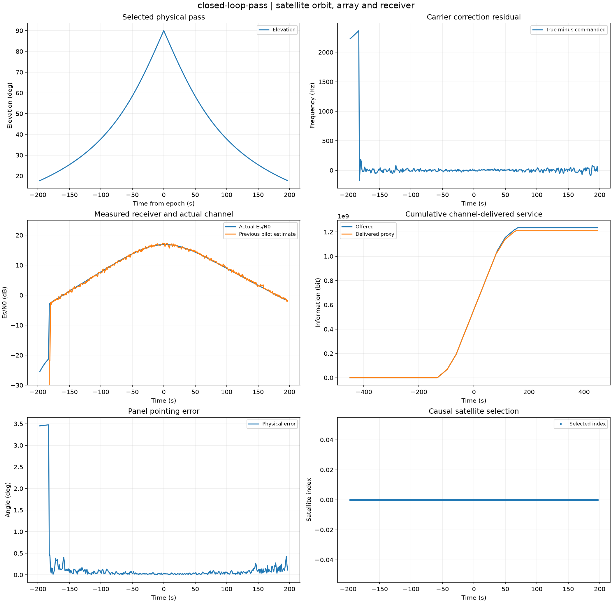
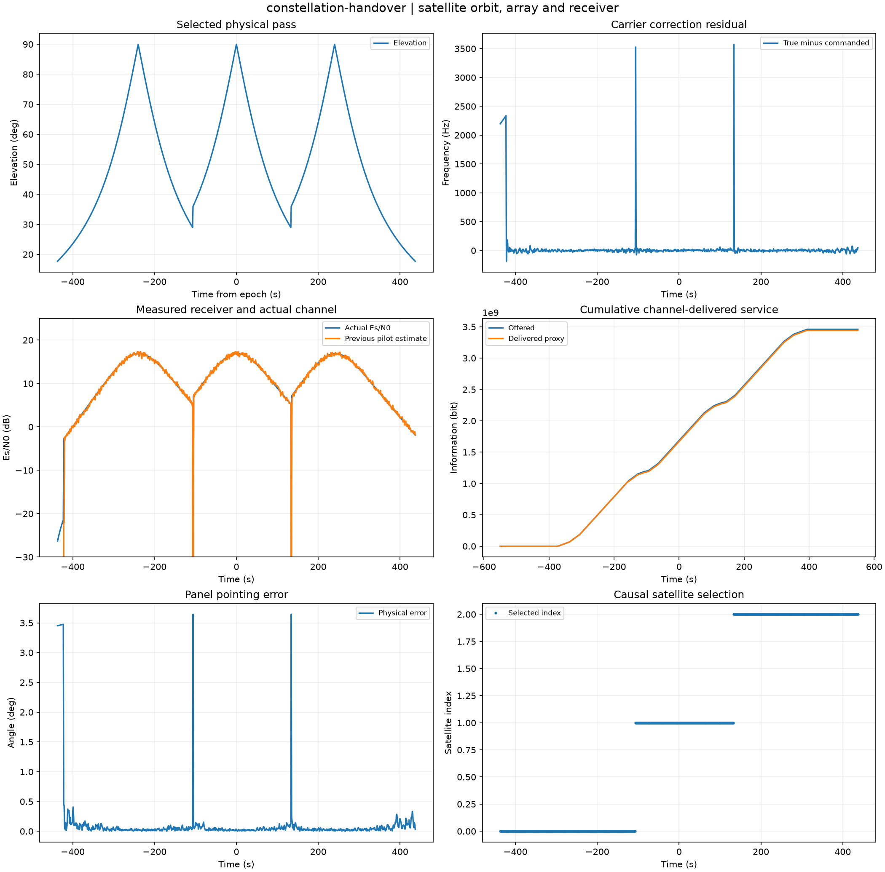
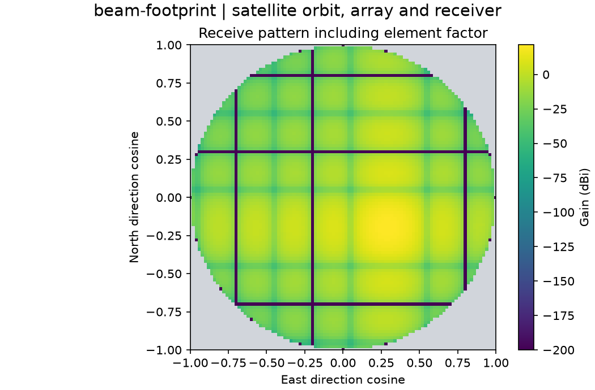
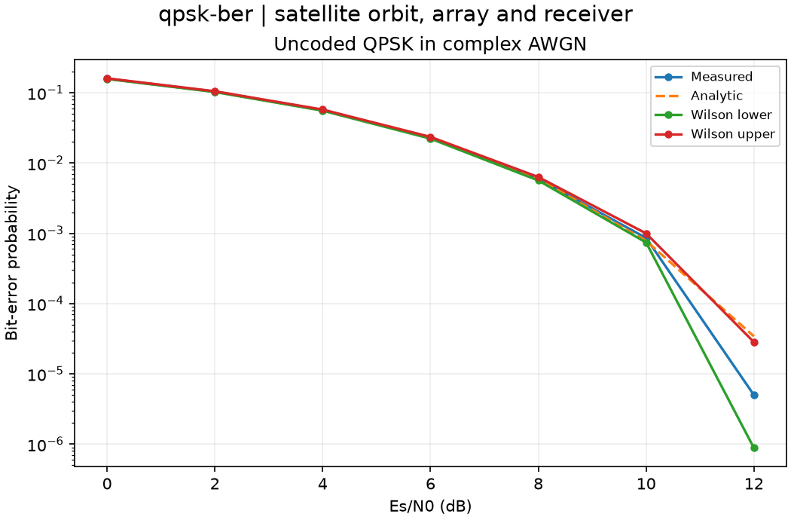
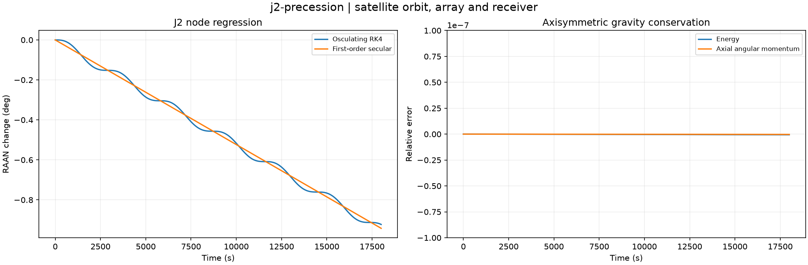

# Computed experiment gallery

Twenty-eight default studies computed from clean source revision [`9a21824463be`](https://github.com/VictorOdoyo/satcom-array-lab/commit/9a21824463bee585d4ba8354070cc9108436346d).
All values below come from the sealed captures. Each case directory contains the complete
NPZ arrays, CSV tables, parameters, provenance, plot and HTML report.

HTML files can be opened locally; GitHub previews the figures and tables directly.

| Study | Selected measured outputs | Artifacts |
| --- | --- | --- |
| [closed-loop-pass](gallery/closed-loop-pass/figure.png) | delivered_mbit = 1210.3; handovers = 0 | [summary](gallery/closed-loop-pass/summary.csv), [setup](gallery/closed-loop-pass/parameters.json), [archive](gallery/closed-loop-pass/fields.npz), [report](gallery/closed-loop-pass/index.html) |
| [ephemeris-only-pass](gallery/ephemeris-only-pass/figure.png) | delivered_mbit = 55.1; handovers = 0 | [summary](gallery/ephemeris-only-pass/summary.csv), [setup](gallery/ephemeris-only-pass/parameters.json), [archive](gallery/ephemeris-only-pass/fields.npz), [report](gallery/ephemeris-only-pass/index.html) |
| [rain-fade-pass](gallery/rain-fade-pass/figure.png) | delivered_mbit = 271.7; handovers = 0 | [summary](gallery/rain-fade-pass/summary.csv), [setup](gallery/rain-fade-pass/parameters.json), [archive](gallery/rain-fade-pass/fields.npz), [report](gallery/rain-fade-pass/index.html) |
| [one-bit-phase-pass](gallery/one-bit-phase-pass/figure.png) | delivered_mbit = 813.2; handovers = 0 | [summary](gallery/one-bit-phase-pass/summary.csv), [setup](gallery/one-bit-phase-pass/parameters.json), [archive](gallery/one-bit-phase-pass/fields.npz), [report](gallery/one-bit-phase-pass/index.html) |
| [calibration-error-pass](gallery/calibration-error-pass/figure.png) | delivered_mbit = 896.8; handovers = 0 | [summary](gallery/calibration-error-pass/summary.csv), [setup](gallery/calibration-error-pass/parameters.json), [archive](gallery/calibration-error-pass/fields.npz), [report](gallery/calibration-error-pass/index.html) |
| [element-failure-pass](gallery/element-failure-pass/figure.png) | delivered_mbit = 917.7; handovers = 0 | [summary](gallery/element-failure-pass/summary.csv), [setup](gallery/element-failure-pass/parameters.json), [archive](gallery/element-failure-pass/fields.npz), [report](gallery/element-failure-pass/index.html) |
| [aperture-outage-pass](gallery/aperture-outage-pass/figure.png) | delivered_mbit = 0; handovers = 0 | [summary](gallery/aperture-outage-pass/summary.csv), [setup](gallery/aperture-outage-pass/parameters.json), [archive](gallery/aperture-outage-pass/fields.npz), [report](gallery/aperture-outage-pass/index.html) |
| [beacon-gap-pass](gallery/beacon-gap-pass/figure.png) | delivered_mbit = 883.5; handovers = 0 | [summary](gallery/beacon-gap-pass/summary.csv), [setup](gallery/beacon-gap-pass/parameters.json), [archive](gallery/beacon-gap-pass/fields.npz), [report](gallery/beacon-gap-pass/index.html) |
| [beacon-outlier-pass](gallery/beacon-outlier-pass/figure.png) | delivered_mbit = 1210.3; handovers = 0 | [summary](gallery/beacon-outlier-pass/summary.csv), [setup](gallery/beacon-outlier-pass/parameters.json), [archive](gallery/beacon-outlier-pass/fields.npz), [report](gallery/beacon-outlier-pass/index.html) |
| [constellation-handover](gallery/constellation-handover/figure.png) | delivered_mbit = 3440.9; handovers = 2 | [summary](gallery/constellation-handover/summary.csv), [setup](gallery/constellation-handover/parameters.json), [archive](gallery/constellation-handover/fields.npz), [report](gallery/constellation-handover/index.html) |
| [spatial-interference-pass](gallery/spatial-interference-pass/figure.png) | delivered_mbit = 570; handovers = 0 | [summary](gallery/spatial-interference-pass/summary.csv), [setup](gallery/spatial-interference-pass/parameters.json), [archive](gallery/spatial-interference-pass/fields.npz), [report](gallery/spatial-interference-pass/index.html) |
| [null-steered-pass](gallery/null-steered-pass/figure.png) | delivered_mbit = 1206.5; handovers = 0 | [summary](gallery/null-steered-pass/summary.csv), [setup](gallery/null-steered-pass/parameters.json), [archive](gallery/null-steered-pass/fields.npz), [report](gallery/null-steered-pass/index.html) |
| [kepler-invariants](gallery/kepler-invariants/figure.png) | max_energy_relative = 2.01342e-14; max_h_relative = 8.61956e-15 | [summary](gallery/kepler-invariants/summary.csv), [setup](gallery/kepler-invariants/parameters.json), [archive](gallery/kepler-invariants/fields.npz), [report](gallery/kepler-invariants/index.html) |
| [rk4-convergence](gallery/rk4-convergence/figure.png) | finest_position_error_m = 0.000976246; observed_order = 4.06459 | [summary](gallery/rk4-convergence/summary.csv), [setup](gallery/rk4-convergence/parameters.json), [archive](gallery/rk4-convergence/fields.npz), [report](gallery/rk4-convergence/index.html) |
| [j2-precession](gallery/j2-precession/figure.png) | max_energy_relative = 6.31273e-10; max_hz_relative = 3.09996e-10 | [summary](gallery/j2-precession/summary.csv), [setup](gallery/j2-precession/parameters.json), [archive](gallery/j2-precession/fields.npz), [report](gallery/j2-precession/index.html) |
| [doppler-range-derivative](gallery/doppler-range-derivative/figure.png) | interior_max_error_hz = 0.556512 | [summary](gallery/doppler-range-derivative/summary.csv), [setup](gallery/doppler-range-derivative/parameters.json), [archive](gallery/doppler-range-derivative/fields.npz), [report](gallery/doppler-range-derivative/index.html) |
| [hohmann-transfer](gallery/hohmann-transfer/figure.png) | largest_delta_v_m_s = 768.848 | [summary](gallery/hohmann-transfer/summary.csv), [setup](gallery/hohmann-transfer/parameters.json), [archive](gallery/hohmann-transfer/fields.npz), [report](gallery/hohmann-transfer/index.html) |
| [beam-footprint](gallery/beam-footprint/figure.png) | peak_gain_dbi = 21.457 | [summary](gallery/beam-footprint/summary.csv), [setup](gallery/beam-footprint/parameters.json), [archive](gallery/beam-footprint/fields.npz), [report](gallery/beam-footprint/index.html) |
| [beam-squint](gallery/beam-squint/figure.png) | 16000000000.0 = 0.625; 20000000000.0 = 0.4996 | [summary](gallery/beam-squint/summary.csv), [setup](gallery/beam-squint/parameters.json), [archive](gallery/beam-squint/fields.npz), [report](gallery/beam-squint/index.html) |
| [aperture-tapers](gallery/aperture-tapers/figure.png) | hamming_peak_dbi = 14.557; hann_peak_dbi = 13.3801 | [summary](gallery/aperture-tapers/summary.csv), [setup](gallery/aperture-tapers/parameters.json), [archive](gallery/aperture-tapers/fields.npz), [report](gallery/aperture-tapers/index.html) |
| [constrained-null](gallery/constrained-null/figure.png) | conventional_sinr = 0.176404; null_sinr = 60.382 | [summary](gallery/constrained-null/summary.csv), [setup](gallery/constrained-null/parameters.json), [archive](gallery/constrained-null/fields.npz), [report](gallery/constrained-null/index.html) |
| [phase-quantization](gallery/phase-quantization/figure.png) | worst_one_bit_loss_db = -5.48737 | [summary](gallery/phase-quantization/summary.csv), [setup](gallery/phase-quantization/parameters.json), [archive](gallery/phase-quantization/fields.npz), [report](gallery/phase-quantization/index.html) |
| [qpsk-ber](gallery/qpsk-ber/figure.png) | max_absolute_error = 0.000489746 | [summary](gallery/qpsk-ber/summary.csv), [setup](gallery/qpsk-ber/parameters.json), [archive](gallery/qpsk-ber/fields.npz), [report](gallery/qpsk-ber/index.html) |
| [burst-acquisition](gallery/burst-acquisition/figure.png) | ber = 0; bit_errors = 0 | [summary](gallery/burst-acquisition/summary.csv), [setup](gallery/burst-acquisition/parameters.json), [archive](gallery/burst-acquisition/fields.npz), [report](gallery/burst-acquisition/index.html) |
| [coherent-frequency-loss](gallery/coherent-frequency-loss/figure.png) | max_power_difference = 3.33337e-07 | [summary](gallery/coherent-frequency-loss/summary.csv), [setup](gallery/coherent-frequency-loss/parameters.json), [archive](gallery/coherent-frequency-loss/fields.npz), [report](gallery/coherent-frequency-loss/index.html) |
| [atmosphere-noise](gallery/atmosphere-noise/figure.png) | zenith_rain_attenuation_db = 6.97656 | [summary](gallery/atmosphere-noise/summary.csv), [setup](gallery/atmosphere-noise/parameters.json), [archive](gallery/atmosphere-noise/fields.npz), [report](gallery/atmosphere-noise/index.html) |
| [link-budget-tradeoff](gallery/link-budget-tradeoff/figure.png) | near_range_eirp_dbw = 16.8832 | [summary](gallery/link-budget-tradeoff/summary.csv), [setup](gallery/link-budget-tradeoff/parameters.json), [archive](gallery/link-budget-tradeoff/fields.npz), [report](gallery/link-budget-tradeoff/index.html) |
| [adaptive-mode-hysteresis](gallery/adaptive-mode-hysteresis/figure.png) | mode_changes = 5 | [summary](gallery/adaptive-mode-hysteresis/summary.csv), [setup](gallery/adaptive-mode-hysteresis/parameters.json), [archive](gallery/adaptive-mode-hysteresis/fields.npz), [report](gallery/adaptive-mode-hysteresis/index.html) |

## Selected fields and diagnostics

### closed-loop-pass

### constellation-handover

### beam-footprint

### qpsk-ber

### j2-precession

## Interpretation

Synthetic orbital, array and receiver studies. Pointing and carrier filters consume noisy beacon observations after the current service decision. ACM results use illustrative thresholds; QPSK BER is separately simulated without FEC. The rain layer is illustrative, and the station is a synthetic site.

Reproduce with `satlab batch --data-only --output outputs/catalog`, then `satlab render outputs/catalog` and `satlab verify outputs/catalog`. Replay retains original source provenance.
